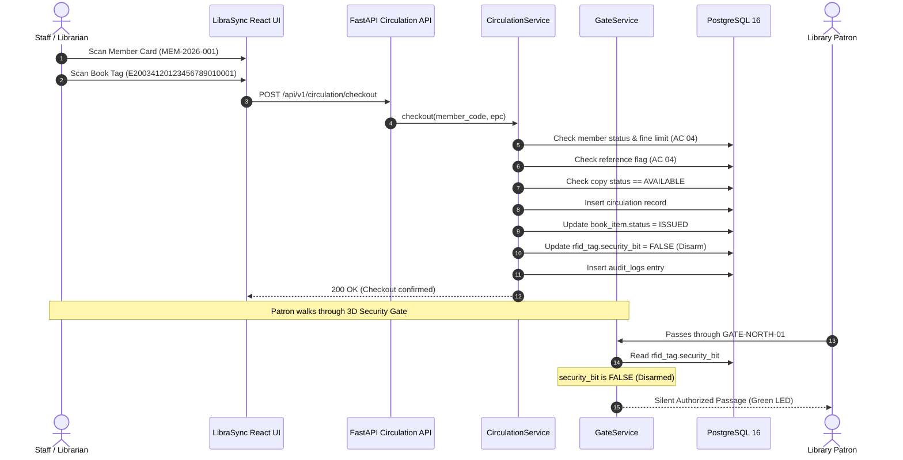

# LibraSync Architecture Documentation

## 1. High-Level System Architecture

LibraSync is structured as a **modular monolith** with decoupled integration adapters and device-neutral middleware. It adheres strictly to the seven logical layers defined on Page 4 of the AISYS Software Development SOP:

```
+-------------------------------------------------------------------------+
|                         1. PRESENTATION LAYER                           |
|       Staff Portal · Circulation Desk · OPAC · Inventory · Gates        |
|        (React 19 · TypeScript · Vite · Tailwind CSS · Recharts)         |
+-------------------------------------------------------------------------+
                                    │
                                    ▼ HTTP / JSON (REST)
+-------------------------------------------------------------------------+
|                        2. API & SECURITY LAYER                          |
|         FastAPI · Argon2 Password Hashing · Signed Bearer JWT           |
|                Role-Based Access Control (RBAC) · Pydantic              |
+-------------------------------------------------------------------------+
                                    │
                                    ▼ Direct In-Process Dependency Injection
+-------------------------------------------------------------------------+
|                        3. APPLICATION SERVICES                          |
|  CatalogService · MemberService · CirculationService · FineService      |
|  InventoryService · GateService · MigrationService · AuditService       |
+-------------------------------------------------------------------------+
                     │                                   │
                     ▼                                   ▼
+-----------------------------------+   +---------------------------------+
|  4. INTEGRATION & MIDDLEWARE      |   |       5. PERSISTENCE LAYER      |
|  RFID Adapters:                   |   |  Primary: PostgreSQL 16         |
|  - Staff Near-Field Desktop Pad   |   |  Fallback: Local SQLite (Dev)   |
|  - Handheld Mobile Gun Simulator  |   |  Tables: 18 relational models   |
|  - 3D Perimeter Security Gate     |   |  Staging Buffer & Audit Ledger  |
|  - Contactless Smart Card (13.56M)|   +---------------------------------+
|  Protocol Boundaries:             |
|  - NCIP 2.0 Adapter               |
|  - 3M SIP2 Adapter                |
|  - Mock ILMS Safe Isolation       |
|  - Mock Optical CCTV Camera       |
+-----------------------------------+
                                    │
                                    ▼
+-------------------------------------------------------------------------+
|                         6. OPERATIONS LAYER                             |
|     Docker Compose Orchestration · Health Check Telemetry · Logging     |
|      Disaster Recovery SQL Snapshots · Atomic Migration Rollback        |
+-------------------------------------------------------------------------+
```

---

## 2. Core Architectural Decisions & Rationales

### Decision 1: Modular Monolith vs. Microservices
* **Evaluation Context**: The AISYS technical evaluation requires clean boundaries without wasting time managing unnecessary microservices network latency, distributed transactions, and multiple repository deployments.
* **Architecture**: LibraSync organizes services into distinct domain modules (`catalog_service.py`, `circulation_service.py`, `gate_service.py`) sharing a transactional PostgreSQL operational database, with external interfaces encapsulated behind adapter interfaces.

### Decision 2: Strict Isolation of External ILMS Database (SOP Pages 1 & 3)
* **Problem**: Many legacy campus library installations experience corrupt catalog or circulation state when third-party tools execute direct `UPDATE` or `DELETE` SQL queries against legacy ILMS databases (such as Koha, Sierra, or Voyager).
* **Engineering Solution**: LibraSync treats any external ILMS database as strictly read-only and foreign. LibraSync maintains its own operational database (`librasync`) and communicates with the legacy ILMS exclusively via standardized protocol contracts (`NCIP 2.0`, `SIP2`, and documented adapter classes).

### Decision 3: Device-Neutral RFID Hardware Abstraction
* **Problem**: Library hardware vendors (e.g. FE Technologies, Nedap, TagSys, 3M) provide proprietary SDKs. Hardcoding vendor-specific DLLs locks the application to proprietary hardware.
* **Engineering Solution**: Implemented abstract base class `RFIDReader` (`connect()`, `read_tags()`, `disconnect()`). Concrete adapters translate physical device events into normalized `RFIDEvent` dictionaries before passing to domain services.

---

## 3. Data Flow: Circulation Lifecycle (AC 03)



