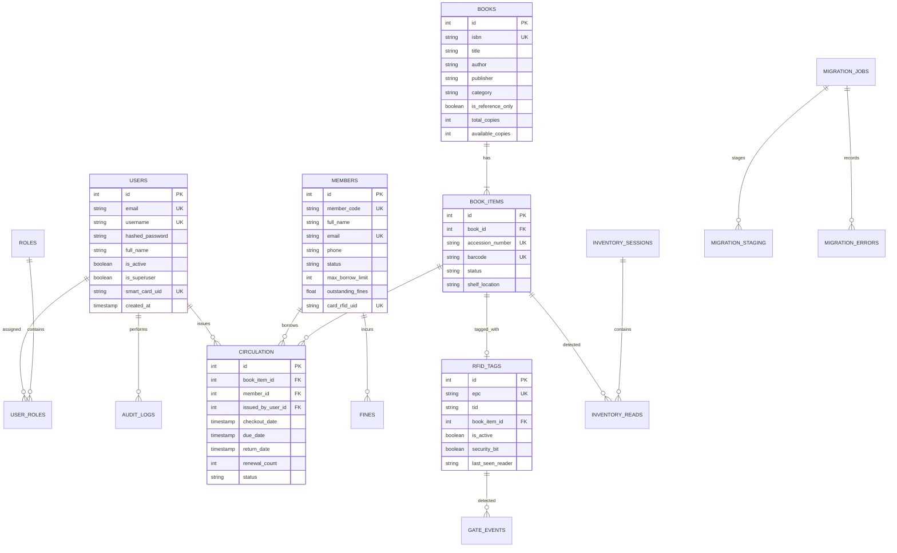

# LibraSync Database Design & Relational Model

## 1. Relational Entity Relationship Diagram

---

## 2. Table Catalog

| Table | Responsibility | Key Constraints |
| :--- | :--- | :--- |
| `users` | Staff credentials & smart-card identity | Unique `email`, `username`, `smart_card_uid` |
| `roles` | Staff permission levels (`Admin`, `Librarian`, `Operator`) | Unique `name` |
| `user_roles` | Role assignments | Foreign keys to `users.id` & `roles.id` |
| `members` | Library patron records & borrowing standing | Unique `member_code`, `email`, `card_rfid_uid` |
| `books` | Bibliographic title catalog | Unique `isbn` |
| `book_items` | Individual physical copies | Unique `accession_number` |
| `rfid_tags` | UHF Gen 2 RFID transponders | Unique `epc`, 1-to-1 unique `book_item_id` |
| `circulation` | Issue, renewal, and return transactions | Foreign keys to `book_items`, `members`, `users` |
| `fines` | Overdue and penalty ledger | Foreign keys to `circulation` and `members` |
| `inventory_sessions`| Audit scan sessions | Tracks initiated staff and targets |
| `inventory_reads` | Handheld antenna reads | Compares detected vs expected shelf |
| `gate_events` | Security perimeter breach events | Captures reader, EPC, alarm, and CCTV URL |
| `notifications` | Outbound email, SMS, and print slips | Queued dispatch architecture |
| `audit_logs` | Immutable operational ledger | Records operator ID, action, timestamp |
| `migration_jobs` | Spreadsheet staging jobs | Tracks state (`UPLOADED`, `VALIDATED`, `EXECUTED`) |
| `migration_staging`| Uncommitted raw spreadsheet rows | Isolated staging buffer |
| `migration_errors` | Specific row-by-row failure reasons | Preserves data integrity |
| `outbox_events` | Reliable integration event queue | Guarantees at-least-once delivery |

