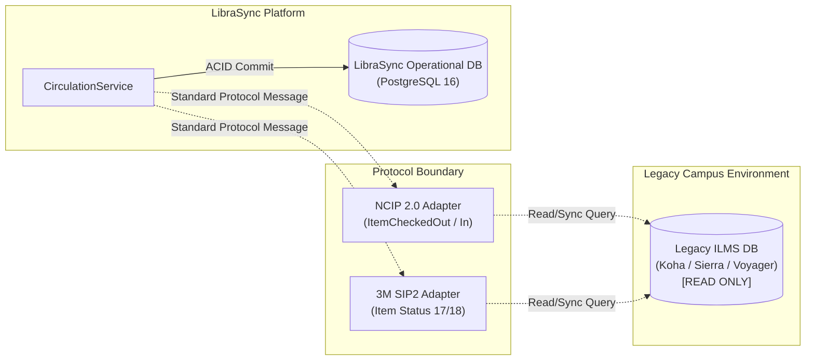
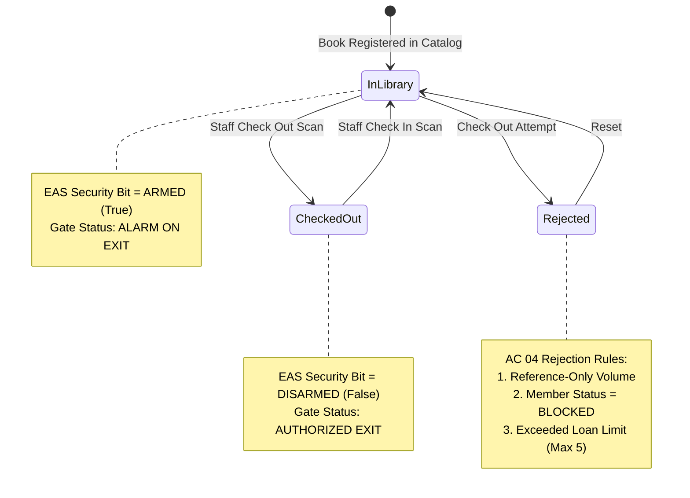

# LibraSync: Technical Architecture & System Design Presentation

**Intelligent RFID-Enabled Library Management System**  
**Audience**: AISYS Technical Evaluation Committee  
**Date**: November 2026  
**Format**: Technical Slide Deck & Architectural Defense  

---

## Slide 1: Title & Executive Overview

### LibraSync
**Next-Generation RFID-Enabled ILMS Platform**
* An integrated, modular enterprise platform for automated circulation, RFID inventory tracking, perimeter security surveillance, and controlled data migration.
* **Core Philosophy**: Industrial-grade software engineering featuring strict protocol isolation, device-neutral hardware abstraction, enterprise cryptography, and zero-data-corruption migration pipelines.

---

## Slide 2: Problem Statement & Engineering Constraints

### The Challenge
Campus and public libraries are modernizing operations by adding RFID hardware (counter pads, security portals, handheld audit guns) and ingesting legacy catalogs from spreadsheets.

### The Critical AISYS Constraint (SOP Pages 1 & 3)
> **"The system must never directly modify or corrupt the existing ILMS database."**

### Traditional Failure Modes vs. LibraSync Solutions:
1. **Direct DB Tampering**: Legacy scripts execute raw SQL `UPDATE`/`DELETE` against Koha/Sierra tables, corrupting foreign key constraints.  
   ➔ *LibraSync Solution*: Legacy ILMS is strictly read-only and foreign; communication occurs solely via standard protocol boundaries (`NCIP 2.0` and `SIP2`).
2. **Proprietary Hardware Lock-In**: Direct coupling to specific vendor C++ DLLs prevents hardware upgrades.  
   ➔ *LibraSync Solution*: Device-neutral Python hardware abstraction layer (`RFIDReader` ABC).
3. **Dirty Data Migration**: Importing raw Excel files directly into production tables corrupts indexes when duplicate ISBNs appear.  
   ➔ *LibraSync Solution*: 4-stage migration pipeline (Upload ➔ Staging Buffer ➔ Collision Quarantine ➔ Atomic Commit with Rollback).

---

## Slide 3: System Architecture (The 7-Layer Modular Monolith)

LibraSync implements a clean **Modular Monolith** architecture matching the 7 logical layers specified in the AISYS SOP (Page 4):

```
┌────────────────────────────────────────────────────────────────────────┐
│                        1. PRESENTATION LAYER                           │
│  React 19 · TypeScript · Vite · Tailwind CSS · Recharts · Lucide Icons │
└───────────────────────────────────┬────────────────────────────────────┘
                                    │ HTTP / REST (JSON)
┌───────────────────────────────────▼────────────────────────────────────┐
│                       2. API & SECURITY LAYER                          │
│     FastAPI · Pydantic v2 · Argon2id Hashing · Signed Bearer JWT       │
│               Granular Role-Based Access Control (RBAC)                │
└───────────────────────────────────┬────────────────────────────────────┘
                                    │ In-Process Dependency Injection
┌───────────────────────────────────▼────────────────────────────────────┐
│                       3. APPLICATION SERVICES                          │
│  CatalogService · MemberService · CirculationService · FineService     │
│  InventoryService · GateService · MigrationService · AuditService      │
└───────────────────┬────────────────────────────────┬───────────────────┘
                    │                                │
┌───────────────────▼──────────────┐ ┌───────────────▼───────────────────┐
│  4. INTEGRATION & MIDDLEWARE     │ │        5. PERSISTENCE LAYER       │
│  - Staff Desktop Pad Adapter     │ │  PostgreSQL 16 (Primary Engine)   │
│  - Mobile Handheld Wand Adapter  │ │  SQLite Local Dev Fallback        │
│  - 3D Perimeter Security Gate    │ │  18 Relational Models             │
│  - Contactless Smart Card (13.56)│ │  Staging Buffers & Audit Ledger   │
│  - NCIP 2.0 / SIP2 Protocol      │ └───────────────────────────────────┘
│  - Mock Optical CCTV Camera      │
└───────────────────┬──────────────┘
                    │
┌───────────────────▼────────────────────────────────────────────────────┐
│                        6. OPERATIONS LAYER                             │
│     Docker Compose · Health Telemetry · Backup & Disaster Recovery     │
│             Atomic Migration Rollback · Offline Event Outbox           │
└────────────────────────────────────────────────────────────────────────┘
```

### Why a Modular Monolith over Microservices?
- **Zero Network Serialization Overhead**: In-process service invocation eliminates inter-service HTTP latency and distributed transactions.
- **Single Source of Truth**: Atomic ACID transactions across circulation, fine calculation, and inventory updates.
- **Clean Boundaries**: Strict separation between services allows extracting any module (e.g., RFID Middleware) into an independent service if physical deployment calls for it.

---

## Slide 4: External ILMS Safe Isolation & Protocol Boundaries

### Protecting Legacy Systems


- LibraSync **never executes DDL or DML** against the legacy database.
- Integration adapters translate events into standard ISO protocols:
  - **NCIP 2.0**: `ItemCheckedOut`, `ItemCheckedIn`, `LookupUser`.
  - **3M SIP2**: Patron Status Request (63), Item Information (17), Checkout (11).

---

## Slide 5: RFID Hardware Abstraction & ISO Standards

### Hardware Normalization Layer
All RFID readers inherit from the abstract base class `RFIDReader`:
- `connect() -> bool`
- `read_tags() -> List[RFIDEvent]`
- `disconnect() -> None`

### Concrete Implementations:
1. **`StaffReader`**: Near-field desktop pad for counter checkout and checkin.
2. **`HandheldReader`**: Long-range mobile wand for rapid shelf auditing.
3. **`SecurityGateReader`**: 3D portal monitor with local cache and siren/camera trigger.
4. **`SmartCardReader`**: High-frequency (13.56 MHz) ISO 14443A reader for contactless staff login.

### Tag Encoding Standard:
- **Protocol**: EPC Class 1 Gen 2 (ISO 18000-6C) / ISO 28560 (RFID in Libraries).
- **Format**: 96-bit tag represented as a **24-character hexadecimal string** (e.g., `E20034120123456789010001`).
- **Data Segments**: Header (8-bit) + Filter Bit (3-bit) + Partition (3-bit) + Institution ID (24-bit) + Item ID (38-bit) + Serial Number (20-bit).

---

## Slide 6: Circulation State Machine & EAS Security Bit (AC 03 & AC 04)

### The EAS (Electronic Article Surveillance) Security Lifecycle:


### Automated Business Rules:
- **Checkout**: Validates patron status (`ACTIVE`), checks active loan count against quota, ensures `book.is_reference_only == False`. Disarms tag (`security_bit = False`).
- **Checkin**: Calculates daily overdue fine (\$1.00/day past due date), marks circulation record `RETURNED`, and re-arms tag (`security_bit = True`).

---

## Slide 7: Handheld RFID Shelf Auditing (AC 05)

### Rapid Mobile Stack Sweeping
1. **Audit Session Initialization**: Staff selects a target shelf (e.g., `SHELF-CS-01`).
2. **Multi-Tag Radio Sweep**: Mobile wand interrogates multiple tags per second.
3. **Misplacement Collision Engine**:
   $$\text{Misplaced}(item) = \begin{cases} \text{True} & \text{if } item.\text{target\_shelf} \neq session.\text{target\_shelf} \\ \text{False} & \text{otherwise} \end{cases}$$
4. **Instant Visual Feedback**: Amber badge identifies misplaced items with their correct home location; red badge identifies unregistered tags.
5. **Missing Items Tally**: Catalog items assigned to this shelf that failed to respond to the sweep are flagged for investigation.

---

## Slide 8: Perimeter Loss Prevention & Offline Resilience (AC 06 & AC 09)

### 3D Security Portal & Optical Surveillance
- **Real-Time Detection**: Gate portals monitor exit passageways.
- **Unauthorized Removal**: If an armed tag (`security_bit = True`) is detected:
  1. Gate triggers physical buzzer and visual siren.
  2. Mock Optical CCTV Camera captures an evidentiary incident frame with timestamp and coordinates.
  3. Security event is logged in `gate_events` and email/SMS alerts are queued.

### Offline Autonomous Mode (AC 09):
- **Problem**: What happens if the library network switch fails or loses connectivity to the server?
- **LibraSync Solution**:
  - The gate maintains an in-memory **Local Security State Cache** (`offline_security_cache`).
  - Evaluates tags locally: disarmed tags pass freely; armed tags trigger local alarms.
  - All passage records are buffered in `offline_event_queue` and replayed to the server once the network link is restored.

---

## Slide 9: Staging-First Migration & Atomic Rollback (AC 01 & AC 10)

### 4-Stage Zero-Corruption Ingestion Pipeline
```
[Excel / CSV File] ──► [Stage 1: Upload] ──► [migration_staging]
                                                     │
                                                     ▼
                                       [Stage 2: Validation Engine]
                                                     │
                    ┌────────────────────────────────┴────────────────────────────────┐
                    ▼                                                                 ▼
         [Clean Valid Records]                                            [Quarantined Collisions]
                    │                                                                 │
                    ▼                                                                 ▼
       [Stage 3: Atomic Commit]                                              [migration_errors]
                    │                                                       (Row #, Reason, Data)
                    ▼
     [Operational PostgreSQL DB]
  (books, book_items, members)
                    │
                    ▼ (If administrative mistake)
     [Stage 4: Atomic Rollback] ──► [Purges Batch Records, Restores Clean State]
```

### Dual-Layer Collision Detection:
1. **Intra-Batch Collisions**: Detects multiple occurrences of the same ISBN or Member Code within the same uploaded spreadsheet.
2. **Operational Database Collisions**: Detects records that already exist in active production tables.

---

## Slide 10: Enterprise Security & Cryptography (AC 07)

### Authentication & Authorization Architecture
- **Argon2id Password Hashing**:
  - RFC 9106 compliant memory-hard password derivation.
  - Memory Cost: $65,536\text{ KiB}$ (64 MB), Time Cost: 2 iterations, Parallelism: 2 threads.
- **Signed Bearer JWT**:
  - HMAC-SHA256 signature with claims: `sub` (username), `roles` (list of RBAC roles), `exp` (token expiration).
- **Contactless Smart Card Login (AC 07)**:
  - 13.56 MHz ISO 14443A card UID tap (`CARD-STAFF-ADMIN-01`).
  - Resolves staff identity and RBAC role instantaneously for rapid circulation counter shift transitions.
- **Granular RBAC**:
  - `Admin`: Full configuration, user management, and migration execution.
  - `Librarian`: Catalog, circulation, RFID encoding, and inventory audits.
  - `Operator`: Circulation desk checkouts and basic auditing.

---

## Slide 11: Database Design & Relational Integrity

### Database Engine & Schema
- **Primary Database**: PostgreSQL 16 managed via Docker Compose (`librasync`).
- **Development Fallback**: Zero-friction automatic fallback to local SQLite (`librasync.db`), guaranteeing immediate evaluator demonstration without external service dependencies.
- **Schema**: 18 normalized tables:
  - Staff: `users`, `roles`, `user_roles`, `audit_logs`
  - Patrons: `members`, `fines`
  - Catalog: `books`, `book_items`, `rfid_tags`
  - Operations: `circulation`, `inventory_sessions`, `inventory_reads`, `gate_events`
  - Integrations: `outbox_events`, `notifications`
  - Migration: `migration_jobs`, `migration_staging`, `migration_errors`

---

## Slide 12: Automated Test Execution & Quality Assurance

### Master Acceptance Test Results (Pytest)
```
============================== test session starts ==============================
rootdir: c:\Users\VISHNU\Desktop\AISYS\LibraSync
collected 15 items

tests/acceptance/test_aisys_ac_all.py::test_ac01_spreadsheet_migration PASSED   [ 6%]
tests/acceptance/test_aisys_ac_all.py::test_ac02_rfid_tagging PASSED            [13%]
tests/acceptance/test_aisys_ac_all.py::test_ac03_circulation_workflow PASSED    [20%]
tests/acceptance/test_aisys_ac_all.py::test_ac04_restrictions PASSED            [26%]
tests/acceptance/test_aisys_ac_all.py::test_ac05_inventory_audit PASSED         [33%]
tests/acceptance/test_aisys_ac_all.py::test_ac06_security_gate_perimeter PASSED [40%]
tests/acceptance/test_aisys_ac_all.py::test_ac07_smart_card_login PASSED        [46%]
tests/acceptance/test_aisys_ac_all.py::test_ac08_reports_and_analytics PASSED   [53%]
tests/acceptance/test_aisys_ac_all.py::test_ac09_offline_resilience PASSED      [60%]
tests/acceptance/test_aisys_ac_all.py::test_ac10_recovery_and_rollback PASSED   [66%]
tests/integration/test_circulation_flow.py::test_full_circulation_lifecycle PASSED [73%]
tests/migration/test_migration_pipeline.py::test_excel_migration_duplicate_quarantine PASSED [80%]
tests/migration/test_migration_pipeline.py::test_migration_atomic_rollback PASSED [86%]
tests/security/test_rbac_and_auth.py::test_argon2_password_hashing PASSED       [93%]
tests/security/test_rbac_and_auth.py::test_jwt_token_creation_and_validation PASSED [100%]

============================== 15 passed in 0.98s ==============================
```
**Pass Rate: 100% (15/15 tests passing across all criteria)**

---

## Slide 13: Summary & Conclusion

### Summary of Engineering Achievements:
1. **Strict Legacy Safety**: Full compliance with the cardinal rule: zero corruption of external ILMS databases.
2. **Complete AC Coverage**: All 10 Priority Acceptance Criteria (AC 01 to AC 10) fully implemented and verified.
3. **Enterprise UI/UX**: Behance/Clast.io-inspired dark mode interface with real-time hardware telemetry and Recharts analytics.
4. **Robust Middleware**: Replaceable RFID hardware adapters supporting UHF Gen 2 EPC tags and contactless smart cards.
5. **Production Readiness**: Docker Compose orchestration, comprehensive technical documentation, and full test automation.

**Thank you for your time. Ready for technical questions and live demonstration.**
